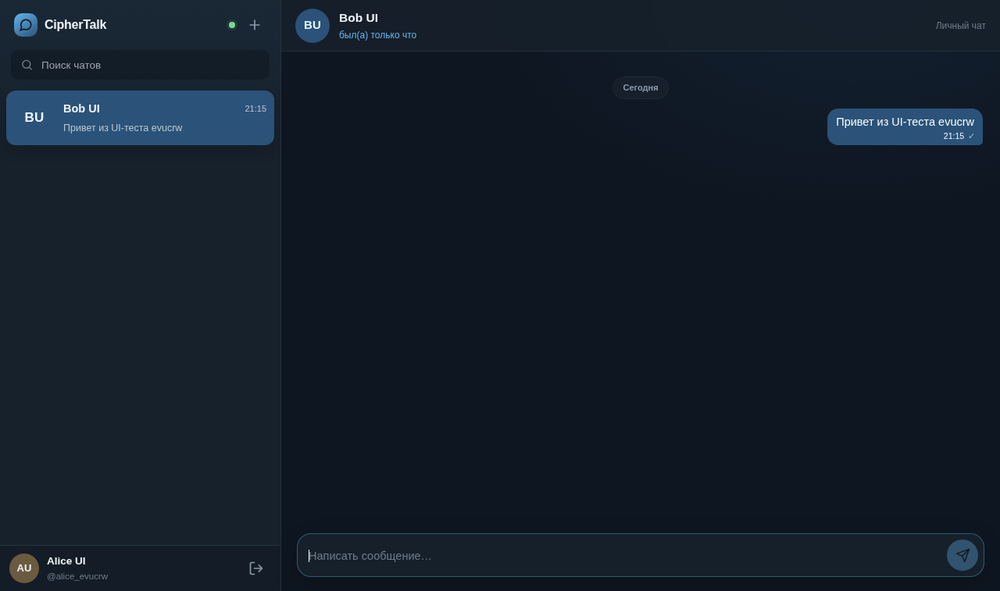
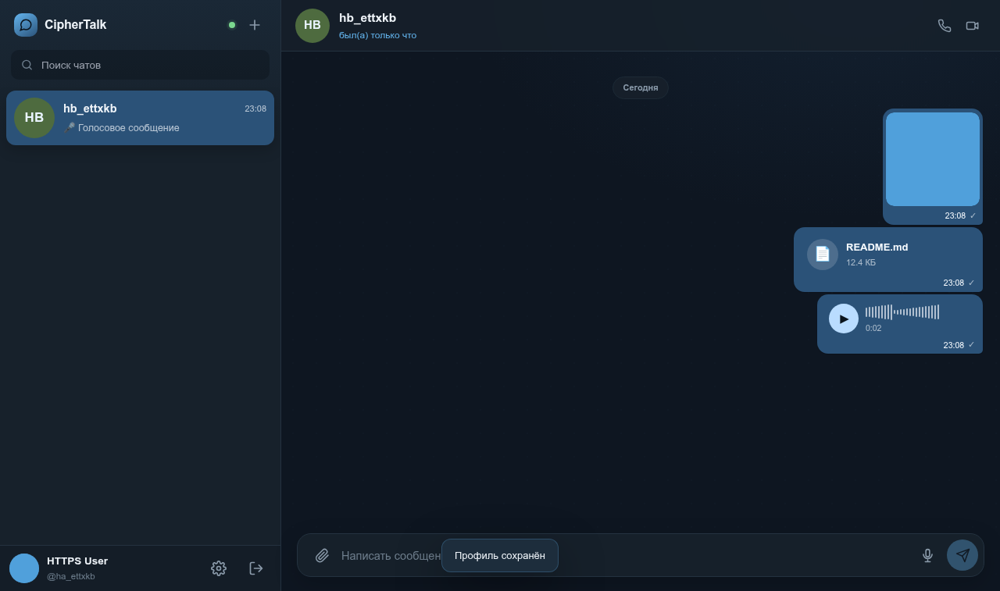
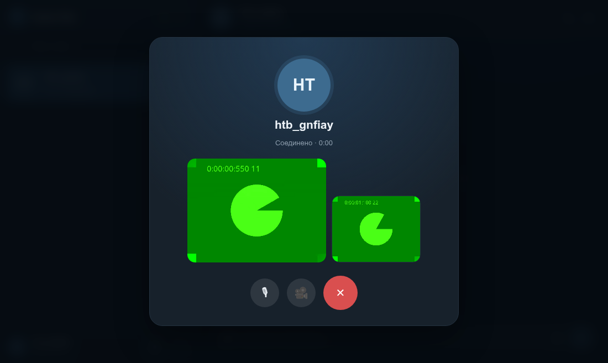

# CipherTalk



Мессенджер уровня Telegram MVP: личные и групповые чаты, фото/видео/файлы и
голосовые сообщения, профиль с аватаром, уведомления в браузере, звонки 1:1
(аудио и видео через WebRTC), история с пагинацией, редактирование и мягкое
удаление, статусы прочтения и «печатает…». Бэкенд — модульный монолит на Rust,
фронтенд раздаётся тем же процессом.

```
Rust 1.88+ · Axum 0.7 · Tokio · PostgreSQL 16+ · SQLx 0.8 · Redis 7+
HTML5 + Tailwind CDN + Vanilla JS · JWT + Argon2id · WebSocket · WebRTC
Nginx TLS · local CA (для камеры/микрофона из LAN)
```

## Быстрый старт: одна команда

```bash
docker compose up --build
```

Откройте <http://localhost:8080>, зарегистрируйте аккаунт, затем второй — в
режиме инкогнито или другом браузере. Найдите второго пользователя через «+»,
создайте личный чат и напишите сообщение. Почта в регистрации необязательна.

> **Важно для звонков и записи голоса.** Браузеры разрешают микрофон/камеру и
> уведомления только в secure context: `https://` или `http://localhost`.
> Docker-конфиг по умолчанию отдаёт HTTP на LAN, поэтому для полноценной работы
> поставьте TLS reverse proxy (пример для armbian — [docs/DEPLOY_ARMBIAN.md](docs/DEPLOY_ARMBIAN.md)).
> Фото, видео и файлы работают и по HTTP.

> Перед публичным запуском обязательно задайте свой `JWT_SECRET`:
>
> ```bash
> JWT_SECRET="$(openssl rand -base64 48)" docker compose up --build -d
> ```
>
> Для HTTPS также включите `COOKIE_SECURE=true`. Если фронтенд открывается с
> другого origin, добавьте его в `CORS_ALLOWED_ORIGINS`; при пустом значении
> разрешены только same-origin запросы и WebSocket с тем же Host.

Проверка контейнеров:

```bash
docker compose ps
docker compose logs -f app
curl -fsS http://localhost:8080/health/ready
```

Миграции применяются автоматически при старте приложения (SQLx embedded
migrations). Данные Postgres и Redis лежат в named volumes.

## Деплой на armbian (HTTPS, WebRTC)

Готовый сервер: **<https://192.168.1.34>** (HTTP `:8080` и `:80` перенаправляют
на HTTPS). Корневой CA для доверия браузеров: <http://192.168.1.34:8080/ca.crt>.

Подробности, пути, systemd/nginx, обновление и установка CA на другие
устройства — [docs/DEPLOY_ARMBIAN.md](docs/DEPLOY_ARMBIAN.md).

## Локальная разработка

Нужны PostgreSQL 16+ и Redis 7+.

```bash
cp .env.example .env
# отредактируйте DATABASE_URL / REDIS_URL и сгенерируйте JWT_SECRET:
# openssl rand -base64 48
cargo run
```

Приложение поднимется на `http://127.0.0.1:8080`. SQL-запросы проверяются на
этапе компиляции, поэтому для `cargo build` нужен либо живой `DATABASE_URL`,
либо заранее подготовленный каталог `.sqlx` (он уже в репозитории):

```bash
# обычная сборка с живой БД
cargo build

# офлайн-сборка без БД
SQLX_OFFLINE=true cargo build

# после изменения SQL-запросов перегенерируйте offline-метаданные
cargo install sqlx-cli --version 0.8.6 --no-default-features --features rustls,postgres
cargo sqlx prepare -- --all-targets
```

Проверки:

```bash
cargo fmt --check
cargo clippy --all-targets -- -D warnings
cargo test --bin ciphertalk
```

`tests/schema_smoke.sql` проверяет триггеры и ограничения схемы на одноразовой
БД:

```bash
createdb ciphertalk_smoke
psql ciphertalk_smoke -v ON_ERROR_STOP=1 -f migrations/0001_schema.sql
psql ciphertalk_smoke -v ON_ERROR_STOP=1 -f migrations/0002_triggers.sql
psql ciphertalk_smoke -v ON_ERROR_STOP=1 -f migrations/0003_media.sql
psql ciphertalk_smoke -v ON_ERROR_STOP=1 -f tests/schema_smoke.sql
dropdb ciphertalk_smoke
```

Полный E2E (HTTP + два WebSocket-клиента) против запущенного сервера:

```bash
pip install requests websockets
python3 tests/e2e.py
```

## Что реализовано

### Аккаунты и сессии
- Регистрация, вход по username или email, Argon2id (19 MiB, t=2, p=1).
- Access JWT HS256 на 15 минут — хранится только в памяти браузера.
- Refresh-токен на 30 дней: случайные 256 бит, в БД только SHA-256, ротация при
  каждом обновлении, HttpOnly/SameSite=Lax cookie с путём `/api/auth`.
- Отзыв сессии, кэш сессий в Redis, авто-refresh на 401, восстановление сессии
  после перезагрузки страницы.
- Профиль, поиск пользователей по username.

### Чаты
- Личный чат идемпотентен: повторное открытие возвращает существующий диалог.
- Группы: название, владелец, администраторы, лимит участников, добавление и
  удаление, выход из группы.
- Список чатов: последнее сообщение, время, непрочитанные, участники, peer для
  личных диалогов.
- Локальный фильтр чатов.

### Сообщения
- Отправка с оптимистичным отображением и индикатором доставки.
- История: `limit`/`offset` и курсоры `before_id`/`after_id`, подгрузка вверх при
  скролле.
- Ответы (reply) с превью, редактирование, мягкое удаление (автор или
  owner/admin группы), tombstone в истории.
- Автоскролл, разделители по датам, статусы ✓/✓✓.

### Медиа и голос
- Фото, видео, произвольные файлы и голосовые сообщения (до 50 МБ).
- Клиентское сжатие фото до 2048 px, превью 640 px, постер видео через canvas.
- Загрузка с прогрессом и отменой, XHR, повтор после refresh токена.
- Защищённая выдача через `/api/attachments/{id}/content` с Range (видео) и
  отдельным HttpOnly-cookie `ct_media`; файлы отдаются как attachment.
- Голосовая запись через MediaRecorder (только HTTPS/localhost), волновая
  дорожка и управление воспроизведением.
- Просмотр фото в полноэкранном viewer, скачивание файлов.



### Профиль
- Смена имени, bio, аватара; кроп и сжатие аватара в браузере.
- Аватары в списке чатов, шапке, профиле; публичный кэшируемый URL.
- Настройки уведомлений.

### Уведомления
- Browser Notification API при новом сообщении, если вкладка не активна.
- Непрочитанные в заголовке вкладки, клик по уведомлению открывает чат.
- Только при открытой вкладке (без Web Push/service worker); на HTTP API
  уведомлений заблокирован браузером.

### Звонки
- 1:1 аудио/видео WebRTC: offer/answer/ICE через существующий WebSocket,
  STUN, mute, камера, таймер, accept/decline, busy и timeout.
- Signaling идёт через Redis Pub/Sub, поэтому работает между инстансами.
- Требуется HTTPS (или localhost) и разрешение на микрофон/камеру.
- Групповые звонки и TURN для сложного NAT пока не входят в MVP.



### Realtime
- `/ws?token=<jwt>`, проверка JWT, сессии и Origin.
- Подписка на чаты с проверкой членства на сервере.
- События: `message.new`, `message.edited`, `message.deleted`, `typing`,
  `read.updated`, `chat.removed`, `call.offer`, `call.answer`, `call.ice`,
  `call.end`, `ready`, `subscribed`, `pong`, `error`.
- Redis Pub/Sub (`ct:events`, `ct:control`) для нескольких инстансов, локальный
  fast-path и дедупликация по `origin`; eviction удалённых участников на всех
  инстансах.
- Heartbeat, exponential backoff с jitter, догрузка пропущенного при реконнекте.
- Статусы прочтения на основе watermark `last_read_message_id`.

### Безопасность
- Все SQL-запросы параметризованы и проверены compile-time (`sqlx::query!`).
- Проверка членства для каждой операции с чатом/сообщением.
- Распределённый fixed-window rate limit в Redis: отдельный строгий лимит для
  auth-маршрутов и общий для API; заголовки `X-RateLimit-*`.
- CORS allowlist, CSP, `X-Frame-Options`, `nosniff`, `Referrer-Policy`,
  `Permissions-Policy` с разрешением камеры/микрофона только для self, HSTS при
  `COOKIE_SECURE=true`.
- Медиа защищены отдельной HttpOnly-cookie, привязанной к сессии и чату;
  изображения/видео отдаются только участникам чата.
- Весь пользовательский текст рендерится через `textContent` (без XSS).
- Секреты не логируются; query string WebSocket не попадает в trace-логи.
- WebSocket-токен передаётся в query (требование ТЗ): используйте HTTPS и
  отключите логирование query string на reverse proxy. Access token живёт 15 минут.

## API

Все ответы — JSON `snake_case`; ошибки:

```json
{"error":{"code":"chat_not_found","message":"Чат не найден"}}
```

| Метод | Путь | Доступ | Назначение |
|---|---|---|---|
| POST | `/api/auth/register` | — | регистрация + cookie |
| POST | `/api/auth/login` | — | вход + cookie |
| POST | `/api/auth/refresh` | cookie | ротация refresh |
| POST | `/api/auth/logout` | Bearer | отзыв сессии |
| GET | `/api/users/me` | Bearer | профиль |
| PATCH | `/api/users/me` | Bearer | имя, bio, avatar_url |
| POST | `/api/users/me/avatar` | Bearer | загрузка аватара (multipart) |
| DELETE | `/api/users/me/avatar` | Bearer | удалить аватар |
| GET | `/api/users/search?q=` | Bearer | поиск по username |
| GET | `/api/chats` | Bearer | список чатов |
| POST | `/api/chats/private` | Bearer | личный чат `{user_id}` |
| POST | `/api/chats/group` | Bearer | группа `{title, member_ids}` |
| GET | `/api/chats/{id}` | Bearer | чат + участники |
| POST | `/api/chats/{id}/members` | Bearer | добавить участников |
| DELETE | `/api/chats/{id}/members/{user_id}` | Bearer | удалить / выйти |
| GET | `/api/chats/{id}/messages` | Bearer | история |
| POST | `/api/chats/{id}/messages` | Bearer | отправить |
| PATCH | `/api/messages/{id}` | Bearer | редактировать |
| DELETE | `/api/messages/{id}` | Bearer | мягко удалить |
| POST | `/api/chats/{id}/read` | Bearer | отметить прочитанным |
| POST | `/api/chats/{id}/attachments` | Bearer | загрузка файла (multipart) |
| GET | `/api/attachments/{id}/content` | media cookie | поток файла, Range |
| GET | `/api/attachments/{id}/thumbnail` | media cookie | превью фото/видео |
| GET | `/ws?token=` | JWT | WebSocket |

Пример WebSocket-сессии:

```json
// клиент → сервер
{"type":"subscribe","chat_id":42}
{"type":"typing","chat_id":42}
{"type":"read","chat_id":42,"message_id":1001}
{"type":"call.offer","call_id":"...","chat_id":42,"sdp":"...","video":false}
{"type":"call.answer","call_id":"...","chat_id":42,"sdp":"..."}
{"type":"call.ice","call_id":"...","chat_id":42,"candidate":{...}}
{"type":"call.end","call_id":"...","chat_id":42,"reason":"ended"}
{"type":"ping"}

// сервер → клиент
{"type":"ready","user_id":7,"session_id":12}
{"type":"message.new","chat_id":42,"message":{...}}
{"type":"typing","chat_id":42,"user_id":9,"display_name":"Bob"}
{"type":"read.updated","chat_id":42,"user_id":9,"message_id":1000}
{"type":"chat.removed","chat_id":42}
{"type":"call.offer","call_id":"...","chat_id":42,"from_user_id":9,"display_name":"Bob","sdp":"...","video":true}
{"type":"call.answer","call_id":"...","chat_id":42,"from_user_id":9,"sdp":"..."}
{"type":"call.ice","call_id":"...","chat_id":42,"from_user_id":9,"candidate":{...}}
{"type":"call.end","call_id":"...","chat_id":42,"from_user_id":9,"reason":"ended"}
```

## Конфигурация

| Переменная | По умолчанию | Описание |
|---|---|---|
| `DATABASE_URL` | — | обязательна, PostgreSQL |
| `DATABASE_MAX_CONNECTIONS` | `10` | размер пула |
| `RUN_MIGRATIONS` | `true` | применять миграции при старте |
| `REDIS_URL` | `redis://127.0.0.1:6379/0` | Redis |
| `JWT_SECRET` | — | обязателен, ≥ 32 байт |
| `JWT_ISSUER` | `ciphertalk` | issuer JWT |
| `ACCESS_TOKEN_TTL_SECS` | `900` | access token |
| `REFRESH_TOKEN_TTL_SECS` | `2592000` | refresh token |
| `COOKIE_SECURE` | `false` | `true` только на HTTPS |
| `MEDIA_TOKEN_TTL_SECS` | `86400` | TTL media-cookie |
| `UPLOAD_DIR` | `uploads` | каталог файлов |
| `MAX_UPLOAD_MB` | `50` | лимит вложения |
| `MAX_AVATAR_MB` | `8` | лимит аватара |
| `HOST` / `PORT` | `0.0.0.0` / `8080` | bind |
| `STATIC_DIR` | `web` | каталог фронтенда |
| `CORS_ALLOWED_ORIGINS` | пусто | список origin через запятую |
| `TRUST_PROXY` | `false` | доверять `X-Forwarded-For` (только за своим прокси) |
| `MAX_MESSAGE_LEN` | `4096` | лимит сообщения |
| `MAX_GROUP_MEMBERS` | `500` | лимит группы |
| `RATE_LIMIT_AUTH_PER_MINUTE` | `20` | auth на IP |
| `RATE_LIMIT_API_PER_MINUTE` | `600` | API на IP |
| `RUST_LOG` | `ciphertalk=info,...` | фильтр логов |

## Архитектура и структура

```
src/
├── main.rs          сборка Router, слои, graceful shutdown
├── config.rs        валидация env
├── db.rs            PgPool, Redis, миграции
├── state.rs         AppState
├── models/          DTO, вложения и WS-события
├── controllers/     HTTP-хендлеры (auth, chats, messages, media)
├── services/        бизнес-логика, SQL, хранение медиа
├── middleware/      auth, Redis rate limit, security headers
├── utils/           ошибки, JWT, Argon2, валидация, пагинация
└── ws.rs            реестр соединений, комнаты, Redis Pub/Sub
web/
├── index.html       экран входа и двухпанельный интерфейс
├── app.js           fetch, оптимистичная отправка, WebSocket
└── styles.css       тёмная тема Telegram-палитры, mobile-first
migrations/          SQL-схема, триггеры и медиа
uploads/             локальные файлы (в .gitignore, на сервере /opt/ciphertalk/uploads)
tests/               SQL smoke-тест и Python E2E
.sqlx/               offline-метаданные compile-time SQL
docs/ARCHITECTURE.md подробное описание решений
```

Подробности: [docs/ARCHITECTURE.md](docs/ARCHITECTURE.md), деплой: [docs/DEPLOY_ARMBIAN.md](docs/DEPLOY_ARMBIAN.md).

## Ограничения MVP

Это не полная копия Telegram: пока нет каналов, ботов, историй, секретных
чатов, облачных файлов на 2 ГБ, поиска по сообщениям, пересылки, реакций,
групповых звонков, TURN-сервера для сложного NAT, Web Push при закрытой
вкладке, E2E-шифрования и удаления аккаунта. Звонки — только 1:1, файлы — до
50 МБ. Уведомления работают при открытой вкладке. Tailwind подключён через CDN
по требованию к простоте; для публичного production его лучше собрать в
статический CSS.

## Лицензия

MIT.
